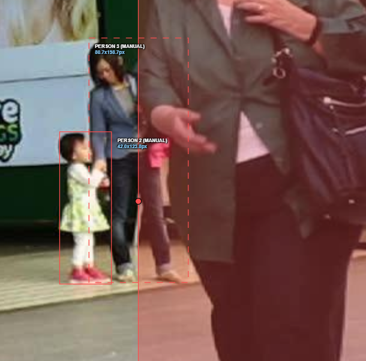
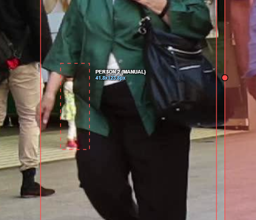
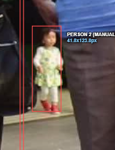

# Báo cáo cá nhân — HoVaTen-MSSV

Đổi tên file theo quy tắc `MSSV_HoTen.md`. Ví dụ: `20241234_NguyenVanAn.md`.

Đoạn video: MOT17-09, 150 frame (frame 1–150), nguồn MOTChallenge, giấy phép CC BY-NC-SA 3.0.

## 0. Thông tin học viên

- Họ tên:Nguyễn Viết Minh Hoàng
- MSSV:2A202603281
- Mã đề (A/B/C):B
- Email:mihhoang307@gmail.com 
- Link repository:https://github.com/hoangnvm307/K5-L2-DAY05-NguyenVietMinhHoang-2A202603281-MOTTracking
- Giờ bắt đầu:16h15
- Giờ kết thúc:18h30

## 1. Xem trước đoạn video (CP0)

Ghi **trước khi vẽ**, mỗi người một dòng.

| Mã | Frame xuất hiện | Frame cuối thấy được | Rẽ / dừng / đổi tốc độ ở frame | Bị che ở frame | Ghi chú |
|---|---:|---:|---:|---:|---|
| P1 | 0 | 141 | 28 | 112 |  |
| P2 | 0 | 149 | 72 | 42 |  |
| P3 | 0 | 110 | 34 | 110 |  |
| P4 | 0 | 149 | | |  |
| P5 | 0 | 149 | | |  |

## 2. Keyframe và thời gian (CP1, CP4)

Số keyframe lấy từ kết quả `src/check_submission.py`.

| Mã | Số keyframe | Keyframe ở frame | Số frame có mặt | Keyframe / 100 frame | Thời gian (phút) | Chỗ khó |
|---|---:|---|---:|---:|---|---|
| P1| 15 | 0, 10, 20, 30, 50, 60, 70, 80, 90, 100, 110, 120, 130, 140, 149 | 140 | 10,7 | Chưa ghi riêng | Giữ cùng ID qua đoạn bị che hoàn toàn từ frame 40 đến 49, rồi chỉnh lại box khi hiện ở frame 50. |
| P2| 39 | 0, 9, 10, 12, 13, 14, 15, 16, 17, 18, 19, 20, 21, 22, 24, 25, 26, 27, 28, 29, 31, 32, 34, 40, 50, 60, 70, 75, 80, 90, 100, 110, 115, 120, 125, 130, 135, 140, 149 | 150 | 26,0 | Chưa ghi riêng | Chỉnh vị trí và kích thước box thường xuyên ở đoạn frame 9–34 để box bám sát người. |
| P3  | 23 | 0, 10, 20, 30, 40, 50, 60, 68, 70, 80, 82, 84, 90, 91, 95, 100, 105, 110, 120, 125, 130, 140, 149 | 150 | 15,3 | Chưa ghi riêng | Ở đầu clip chỉ thấy một phần người sát mép phải. Cần mở rộng box dần khi ông ấy bước vào khung hình. |
| P4  | 19 | 0, 5, 10, 15, 20, 25, 30, 40, 45, 50, 70, 90, 100, 108, 109, 110, 135, 141, 143 | 123 | 15,4 | Chưa ghi riêng | Box nhỏ và em bé đi sát người lớn. Cần kiểm tra kỹ đoạn bị che rồi hiện lại. |
| P5 | 9 | 0, 10, 20, 25, 30, 35, 40, 50, 90 | 106 | 8,5 | Chưa ghi riêng | Cần phân biệt box của cô ấy với box của em bé khi hai người đi sát nhau và kiểm tra lúc cô ấy mất khỏi tầm nhìn. |
| Tổng | 105 | — | 669 | 15,7 | — | — |

Keyframe / 100 frame của cả bài = tổng keyframe ÷ tổng số frame có mặt × 100 = 105 ÷ 669 × 100 ≈ 15,7 keyframe / 100 frame.

Bạn đặt keyframe nhiều nhất ở người nào? Vì sao (người đó rẽ, dừng, lại gần camera hay bị che)?
P2 với 39 keyframe. Ở đoạn frame 9–34, người này di chuyển sang trái trong ảnh và kích thước box thay đổi. Tôi đặt nhiều mốc ở đoạn này để box nội suy bám sát người.
...

## 3. Đoạn bị che (CP2)

Người bị che: `P4`(em bé áo vàng)

| Mốc | Frame |
|---|---:|
| Bắt đầu bị che một phần (bật `occluded`) | 108|
| Mất hẳn (bật `outside`) | 111 |
| Hiện lại (tắt `outside`) | 135 |
| Thấy rõ trở lại (tắt `occluded`) | 141 |

- Thời gian khuất hẳn: 24 frame = 0.8 giây.
- Quyết định: giữ cùng ID .
- Lý do (trả lời 3 câu: khuất bao lâu so với 60 frame, ngoại hình có khớp, chỗ hiện lại có đúng hướng và tốc độ):

...

Ảnh chụp màn hình:

## 4. Tự review ID (CP3)

Lượt 1 theo người (đi ngược từ frame 149 về 0 trên CVAT), lượt 2 theo cảnh (nhảy 10 frame). Ít nhất 3 dòng; không có lỗi thì ghi một dòng "đã kiểm hai lượt, không lỗi".

Loại lỗi dùng đúng một trong 7 mã: `id_switch`, `fragmentation`, `lost`, `merge`, `false_track`, `drift`, `flag`.

| Frame | Mã người | Loại lỗi | Mô tả một câu | Phát hiện ở lượt | Đã sửa? |
|---:|---|---|---|---|---|
| 80 | P3 | flag |  nhìn rõ nhưng vẫn có cờ occlude | lượt đầu | Đã sửa |
| 107 | P4 |  flag | 	Tay của người đi phía trước đã che một phần em bé nhưng occluded đến frame 108 mới bật | lượt đầu | Đã sửa |

Tổng hợp số lỗi theo loại:

| `id_switch` | `fragmentation` | `lost` | `merge` | `false_track` | `drift` | `flag` |
|---:|---:|---:|---:|---:|---:|---:|
| | | | | | |2 |

Lỗi nào chỉ lượt 2 (theo cảnh) mới thấy, lượt 1 (theo người) không thấy? Vì sao?

Không có lỗi chỉ lượt 2 mới thấy

## 5. File xuất và kết quả tự kiểm (CP4)

| Kiểm tra | Kết quả |
|---|---|
| Tên file MOT 1.1 |	NguyenVietMinhHoang_mot.zip |
| Tên file CVAT for video 1.1 | NguyenVietMinhHoang_cvat_video.zip |
| Số track ID khác nhau trong `gt/gt.txt` (phải là 5) | 5 |
| Frame `outside` không có dòng trong `gt.txt` (đúng / sai) |đúng |
| Job đã completed trên CVAT máy cá nhân |CCó |

Dán phần tóm tắt in ra từ `src/check_submission.py`:

Số frame in theo CVAT (bắt đầu từ 0). Trong gt.txt, frame_id = frame CVAT + 1.

=== File MOT 1.1: NguyenVietMinhHoang_mot.zip ===
  Số track ID: 5   |   Tổng số box: 669
  [OK]        Đúng 5 track ID.

  Track | Frame có mặt | Số frame | Đoạn vắng (outside)
      1 |   0–149      |      150 | -
      2 |   0–146      |      123 | 111–134
      3 |   0–105      |      106 | -
      4 |   0–149      |      140 | 40–49
      5 |   0–149      |      150 | -

=== File CVAT for video 1.1: NguyenVietMinhHoang_cvat_video.zip ===

  Track | Nhãn   | Frame thấy | Keyframe | KF/100 frame | Frame occluded | Lần bật outside
      0 | person |        150 |       39 |         26.0 |              0 |   0
              Track 0: keyframe ở frame [0, 9, 10, 12, 13, 14, 15, 16, 17, 18, 19, 20, 21, 22, 24, 25, 26, 27, 28, 29, 31, 32, 34, 40, 50, 60, 70, 75, 80, 90, 100, 110, 115, 120, 125, 130, 135, 140, 149]
      1 | person |        123 |       19 |         15.4 |             13 |   2
              Track 1: keyframe ở frame [0, 5, 10, 15, 20, 25, 30, 40, 45, 50, 70, 90, 100, 108, 109, 110, 135, 141, 143]
      2 | person |        106 |        9 |          8.5 |             16 |   1
              Track 2: keyframe ở frame [0, 10, 20, 25, 30, 35, 40, 50, 90]
      3 | person |        140 |       15 |         10.7 |             50 |   1
              Track 3: keyframe ở frame [0, 10, 20, 30, 50, 60, 70, 80, 90, 100, 110,120, 130, 140, 149]
      4 | person |        150 |       23 |         15.3 |             70 |   0
              Track 4: keyframe ở frame [0, 10, 20, 30, 40, 50, 60, 68, 70, 80, 82, 84, 90, 91, 95, 100, 105, 110, 120, 125, 130, 140, 149]

  Tổng: 105 keyframe / 669 frame có mặt = 15.7 keyframe / 100 frame
  [OK]        Đọc được 5 track từ annotations.xml.

=== Tóm tắt ===
  Lỗi: 0   |   Cảnh báo: 0
  Đạt. Dán phần tóm tắt này vào báo cáo mục 5.

## 6. Ba câu kết

1. Nếu được gán lại, bạn sẽ đặt keyframe khác ở đâu? Vì sao?

   Tôi sẽ đặt keyframe bật occluded cho P4 ở frame 107 thay vì 108, vì ở frame 107 tay của người đi phía trước đã che một phần em bé. Tôi sẽ giữ keyframe ở frame 135 để chỉnh lại box ngay khi bé xuất hiện.
2. Có chỗ nào bạn không chắc "cùng ID hay ID mới"? Bạn đã quyết định và ghi chú thế nào?

   Tôi không gặp trường hợp nào khiến tôi phân vân. Với P4, em bé khuất hẳn 24 frame, ngắn hơn ngưỡng 60 frame. Khi hiện lại, bé vẫn mặc cùng bộ đồ, đi giày đỏ và xuất hiện gần vị trí trước khi bị che. Vì vậy, tôi giữ cùng ID và ghi lý do ở mục 3.

3. Một lỗi ID trong job của bạn (nếu không còn sót, chọn lỗi đã sửa) có thể làm xe tự lái dự đoán sai chuyển động của người đó như thế nào? Lỗi đó ảnh hưởng MOTA hay IDF1 nhiều hơn?

   Nếu P4 bị gán ID mới ở frame 135, hệ thống có thể hiểu rằng em bé cũ đã biến mất và một người khác vừa xuất hiện. Khi đó, hệ thống mất lịch sử chuyển động trước lúc bé bị che và khó dự đoán vị trí tiếp theo của bé. Nếu ID sai kéo dài qua nhiều frame, IDF1 thường bị ảnh hưởng nhiều hơn vì nó đánh giá việc giữ đúng danh tính xuyên suốt. MOTA tính lỗi đổi ID theo số lần xảy ra.

## Bonus (nếu làm)

### B1 — Hai người đi sát

...

### B2 — So cách đặt keyframe

| Cách đặt | Số keyframe | Frame trôi nhất | Ghi chú |
|---|---:|---:|---|
| Đều mỗi 30 frame | | | |
| Theo chỗ đổi hướng | | | |

...

### B3 — So với tracker có sẵn

| Frame | Mã người | Tracker làm gì | Nhãn của bạn | Giải thích (đoán rồi sửa / ghép IoU / box score thấp / ngoại hình) |
|---:|---|---|---|---|
| | | | | |
| | | | | |

## 7. Tài liệu tham khảo và công cụ AI đã dùng

...
